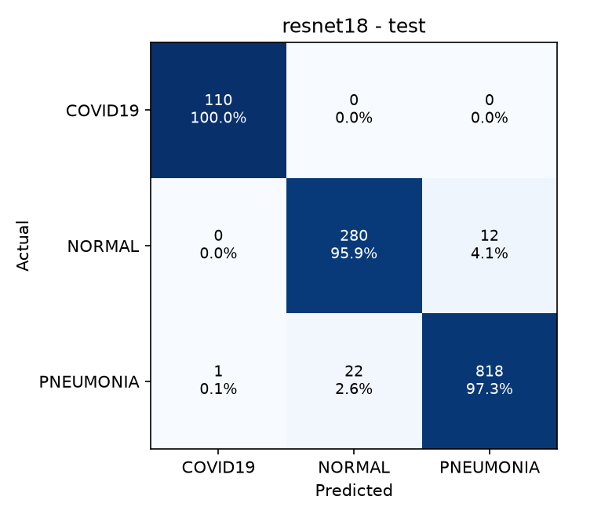
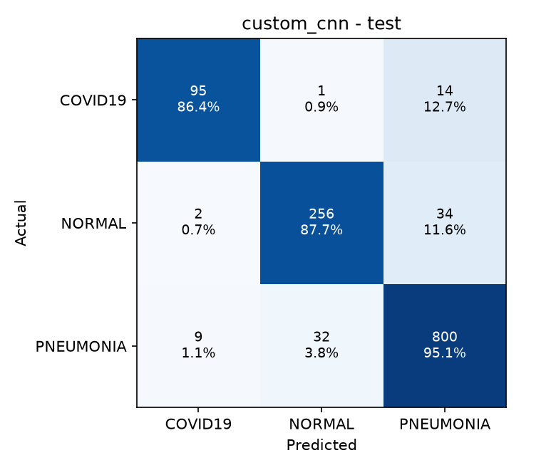
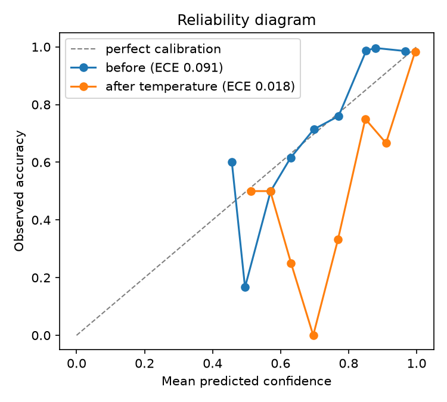
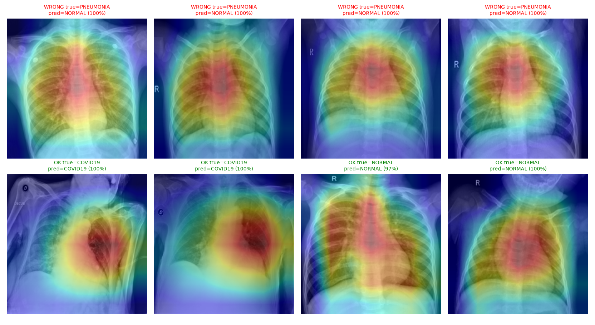
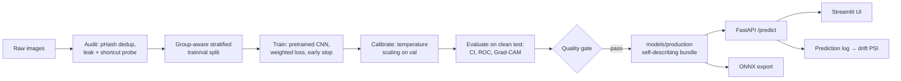

# 🫁 Lung X-ray Classifier — leakage-audited, calibrated & explainable

[](https://github.com/Md-Faiz-Alam/Lungs-Disease-Diagnosis/actions/workflows/ci.yml)


Classifies frontal chest radiographs as **COVID-19, Normal or Pneumonia**. Every prediction
comes with a **calibrated** confidence, a **"refer to a radiologist"** flag when the model
is unsure, and a **Grad-CAM** heatmap showing what the model looked at.

> ⚠️ Research and portfolio project, **not a medical device**. Do not use it for diagnosis.

**The interesting part isn't the CNN, it's what the data audit found.** The public dataset
leaks test images into training and carries strong "which hospital did this come from" shortcuts.
This project measures both, removes the leaks, and reports honest numbers.

---

## Key findings from the data audit

`lungxray audit` scans all 6,432 images with perceptual hashing and probes for shortcuts:

| Finding | Result | What was done |
|---|---|---|
| Test images that are near-duplicates of training images | **45 (3.5% of test)** | Excluded → *clean test set* (both numbers reported) |
| Duplicate groups whose copies carry **different labels** | **19 groups** | Removed as label noise |
| Classifier trained on **file metadata only** (size, colour mode, bytes, no pixels) | **87.4% balanced accuracy** (chance = 33%) | Center-crop preprocessing hides aspect ratio; Grad-CAM audits what the CNN uses |
| Class imbalance | Pneumonia 66% / Normal 25% / COVID 9% | Class-weighted loss; balanced accuracy and per-class recall as the headline metrics |

The metadata result means **image resolution alone nearly identifies the diagnosis**
(Normal median 1615×1322 px vs Pneumonia 1144×776 px): the classes come from different
sources. Any high accuracy on this dataset should be read with that in mind. See
[MODEL_CARD.md](MODEL_CARD.md).

## Results (clean test set, n = 1,243)

All v1 models were trained on a Kaggle T4 GPU with `kaggle/run_kaggle.py`: same seed, same
splits, up to 15 epochs with early stopping on validation balanced accuracy.

| Model | Params | Accuracy | **Balanced acc.** (95% CI) | Macro F1 | Macro AUC | Abnormal sensitivity | ECE |
|---|---|---|---|---|---|---|---|
| v0: original custom CNN (old notebook training) | 11.7K | 0.926 | 0.897 (0.872–0.923) | 0.903 | 0.985 | 0.965 | 0.018 |
| v1: same custom CNN, new pipeline | 11.7K | 0.933 | 0.943 (0.927–0.957) | 0.924 | 0.989 | 0.951 | 0.016 |
| v1: EfficientNet-B0 | 4.0M | 0.963 | 0.973 (0.963–0.981) | 0.964 | 0.995 | 0.964 | 0.017 |
| v1: DenseNet-121 | 7.0M | 0.970 | **0.980 (0.973–0.987)** | 0.972 | 0.996 | 0.968 | 0.022 |
| **v1: ResNet-18 (deployed)** | 11.2M | **0.972** | 0.977 (0.968–0.985) | **0.972** | **0.997** | **0.977** | 0.018 |

**Why ResNet-18 is deployed and not DenseNet-121.** Their balanced-accuracy confidence intervals
overlap almost completely, so the 0.003 gap is noise. ResNet-18 misses the fewest disease cases
(highest abnormal sensitivity: 22 missed vs 33 for v0), has the best AUC, and is
faster at inference. In screening, a missed disease is the costly error, so the model was chosen on
that, not on the headline number.

**The pipeline is worth about 5 points on its own.** The *identical* 11.7K-parameter CNN goes from
0.897 to 0.943 balanced accuracy purely from class-weighted loss, anatomically valid augmentation,
leakage-safe splits and early stopping, without any architecture change.

Calibration: temperature scaling cuts ECE about 5x (deployed ResNet-18: 0.091 → 0.018). *ECE values for
the other rows come from a temperature fit that could stop early (since fixed with a bounded
search, re-verified for ResNet-18), so treat them as approximate.* ONNX Runtime
inference is about 2.5x faster than PyTorch on CPU (~14 ms vs ~35 ms per image), with logits matching to within 1e-6.

**How to read these numbers honestly**
- **COVID-19 is classified almost perfectly (recall 1.000, AUC 1.000).** That's a warning sign, not a
  triumph. Given the metadata probe, the model very likely recognises the COVID source images partly
  from acquisition differences. Only external validation can tell how much is real.
- The remaining errors are mostly Pneumonia called Normal at high confidence, often on paediatric
  films, so calibration alone cannot flag them. A screening deployment should use a lower operating
  threshold for "Normal".
- On the leaky original test set the deployed model scores 0.978 vs 0.977 clean: the 45 leaked
  images were mostly easy. Published numbers on this dataset are still measured on duplicates, though.
- Under 1% of test images fall below the 0.70 referral threshold, and accuracy on the rest is 97.7%.
  The 22 missed pneumonias are confidently wrong, which is exactly why the referral flag can't be the
  only safety net.

*Balanced accuracy is the mean per-class recall, which is robust to the 7:1 class imbalance.
"Abnormal sensitivity" is the share of COVID + Pneumonia cases **not** called Normal (a missed
disease is the costly error). ECE is expected calibration error after temperature scaling.*

| Confusion matrix (v1) | Confusion matrix (v0) | Reliability (calibration) |
|---|---|---|
|  |  |  |

**Grad-CAM, top row = the model's most confident mistakes.** The heatmaps sit on the lung fields and
heart, not on the "R" or "D" markers. The missed pneumonia cases are mostly paediatric films.



## Architecture



## What makes it production-grade

- **Self-describing model bundle**: weights, architecture, classes, preprocessing, temperature and
  metrics live in one file, loaded with `weights_only=True`. Training and serving cannot drift apart.
- **Leakage-safe splits**: near-duplicate groups never straddle train/val/test.
- **Calibration and referral**: temperature scaling, ECE before/after, and predictions below a
  confidence threshold are flagged for human review.
- **Uncertainty in metrics**: 95% bootstrap confidence intervals, not a single number.
- **Explainability**: Grad-CAM written from scratch with hooks, exposed in the API and the UI.
- **Quality-gated promotion**: a run reaches `models/production` only if balanced accuracy and every
  class recall clear thresholds **and** it beats the current production model.
- **API**: FastAPI with input validation (rejects colour photos, tiny or corrupt files), size
  limits, optional API key, batch endpoint and Prometheus `/metrics`.
- **Monitoring**: every prediction is logged, and `lungxray drift` computes the Population Stability
  Index of live inputs and confidence against the training reference.
- **Engineering**: typed config (pydantic + YAML + CLI overrides), 26 pytest tests including an
  end-to-end train→serve run on synthetic data, GitHub Actions CI, Docker and docker-compose,
  and ONNX export with a parity check and latency benchmark.

## Quickstart

```bash
python -m venv .venv && .venv\Scripts\activate          # Windows (source .venv/bin/activate on Linux/macOS)
pip install --index-url https://download.pytorch.org/whl/cpu torch torchvision
pip install -e ".[api,ui,export,dev]"
```

Put the [Kaggle dataset](https://www.kaggle.com/datasets/prashant268/chest-xray-covid19-pneumonia)
in `data/train/<CLASS>` and `data/test/<CLASS>`, then:

```bash
lungxray audit                                    # leakage, duplicates, shortcut probe
lungxray train --set model.name=efficientnet_b0   # train + calibrate + evaluate
lungxray train --set model.name=resnet18 train.epochs=3 --promote
lungxray evaluate --model models/production/model.pt
lungxray export-onnx                              # ONNX + parity check + latency
lungxray predict samples/COVID19_1.jpg
```

### Train on a Kaggle GPU

Create a Kaggle notebook (GPU on, Internet on), add the dataset as input, and run:

```bash
!git clone https://github.com/Md-Faiz-Alam/Lungs-Disease-Diagnosis.git
%cd Lungs-Disease-Diagnosis
!pip install -q -e .
!python kaggle/run_kaggle.py --models efficientnet_b0 resnet18 densenet121 custom_cnn
```

This writes every run plus a `comparison.md` table to `/kaggle/working/artifacts`. Download the
best `model.pt` to `models/production/model.pt`.

### Serve

```bash
uvicorn lungxray.api:app --port 8000              # API docs at http://localhost:8000/docs
streamlit run app/streamlit_app.py                # UI (uses API_URL if set, else loads the model)
docker compose up --build                         # API on :8000 + UI on :8501
```

```bash
curl -F "file=@samples/PNEUMONIA_1.jpg" "http://localhost:8000/predict?explain=false"
```

## Project layout

```
configs/config.yaml          experiment config (override with --set key=value)
src/lungxray/
  data/        audit.py (pHash dedup, leakage, shortcut probe) · dataset.py · prepare.py
  models/      factory.py (5 architectures) · bundle.py (self-describing checkpoint)
  training/    trainer.py · promote.py (quality gate + registry)
  evaluation/  metrics.py (CI, screening view) · calibration.py · report.py · evaluate.py
  explain/     gradcam.py
  inference/   predictor.py (validation, referral, logging)
  api.py · monitoring.py (PSI drift) · export.py (ONNX) · cli.py
app/streamlit_app.py · kaggle/run_kaggle.py · tests/ · Dockerfile · .github/workflows/ci.yml
notebook/Experiment.ipynb    original exploratory notebook (v0 baseline)
```

## Limitations

- Single public dataset assembled from several sources, so the shortcut risk above is real. The
  next step is **external validation** on an independent dataset (e.g. RSNA Pneumonia, NIH
  ChestX-ray14) to measure true generalisation.
- Patient IDs are unavailable, so patient-level leakage can only be approximated with image hashing.
- Labels are image-level only. Grad-CAM is a qualitative sanity check, not a localisation guarantee.

## License

MIT. The dataset is subject to its own Kaggle license.
