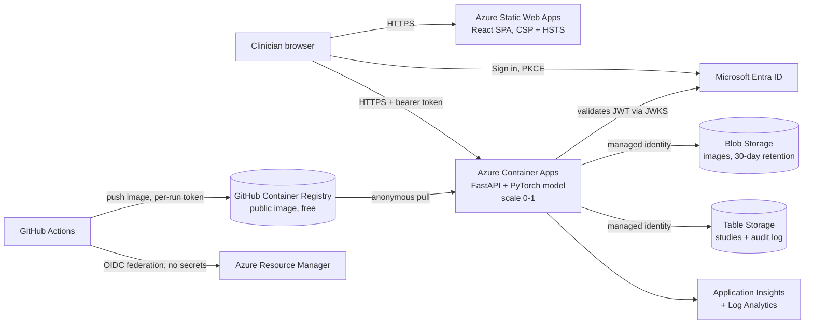
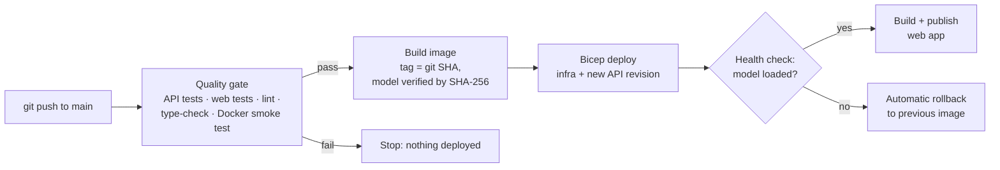

# Azure deployment

Production runs on Azure, is defined entirely as code ([`infra/main.bicep`](../infra/main.bicep)), and deploys
automatically on every push to `main` ([`.github/workflows/deploy.yml`](../.github/workflows/deploy.yml)).

## Architecture



## Security design

| Concern | How it is handled |
|---|---|
| Credentials | **None stored anywhere.** GitHub deploys through OIDC workload identity federation, and the API reaches Storage through a user-assigned managed identity. Storage account keys are disabled (`allowSharedKeyAccess: false`). The image is pushed with the per-run `GITHUB_TOKEN` and pulled anonymously (public package), so no registry credentials exist. |
| Least privilege | The deploy identity is `Contributor` on one resource group only, plus `Role Based Access Control Administrator` with an **ABAC condition** that lets it grant only `Storage Blob Data Contributor` and `Storage Table Data Contributor`. The federated credential accepts tokens only from this repo's `production` environment. |
| User authentication | Microsoft Entra ID with the SPA authorization-code flow + PKCE (no client secret). The API validates the token signature against the tenant JWKS, plus issuer, audience, expiry and the `Studies.ReadWrite` scope. |
| Data isolation | Studies are partitioned by the user's Entra object ID, so one clinician cannot read another's studies (tested). In demo mode each browser gets a random anonymous workspace (`X-Demo-Session` UUID), so public visitors never see each other's uploads. |
| Abuse protection | Model inference is rate-limited per client IP (default 30 per 10 minutes, `RATE_LIMIT_INFERENCE`). Oversized uploads are rejected from `Content-Length` before the body is read. Replicas are capped at 1 (`maxReplicas` in `main.bicep`), which bounds worst-case cost and keeps the per-replica rate limit exact. Every response carries an `X-Request-ID` for tracing. |
| Patient data | DICOM is de-identified on receipt: only pixel data and an allow-list of technical tags are kept, and the original file is never stored. Images are auto-deleted after 30 days (lifecycle policy). Blob soft delete lasts 7 days. Storage uses double encryption at rest and TLS 1.2+. |
| Auditability | Every upload, view, review, report download and deletion is written to an append-only audit table. |
| Web hardening | Content-Security-Policy, HSTS, `X-Frame-Options: DENY`, `nosniff`, no-referrer. Tokens are kept in `sessionStorage` (cleared when the tab closes on shared workstations). API responses are `Cache-Control: no-store`. |
| Supply chain | All Python dependencies are pinned in `requirements-lock.txt` (reproducible images). The model is downloaded at build time from a GitHub Release and **verified by SHA-256**. Images are tagged by git SHA and scanned by Trivy, the container runs as a non-root user, CodeQL analyses every change, and every deploy is smoke-tested before the web app goes live. |
| Cost | No paid registry (GitHub Container Registry is free), Container Apps scales to zero, Static Web Apps is on the free tier, Log Analytics ingestion is capped at 1 GB/day, and a budget alert (`infra/budget.bicep`, created once by bootstrap so the alert e-mail never reaches the public CI logs) fires at 80% actual / 100% forecast spend. |

## Access control: who can change what

| Asset | Who can change it | Enforced by |
|---|---|---|
| Code on `main` | Repository admin only | Ruleset `protect-main`: no deletion or force-push; everyone else must open a PR that passes CI, and only the admin can merge |
| Pull requests from forks | Workflows don't run until the admin approves | Actions setting: approval required for all external contributors |
| Azure resources | Subscription owner | Azure RBAC on the subscription |
| Deployments to Azure | Only workflows running on `main` | `production` environment allows only `main`, and the OIDC federated credential trusts only that environment |
| Running app's data | The API's managed identity only | Storage RBAC; account keys disabled |

## One-time setup (about 15 minutes)

Prerequisites: an Azure subscription where you are Owner (Azure for Students works), the
[Azure CLI](https://learn.microsoft.com/cli/azure/install-azure-cli), and the GitHub CLI (`gh auth login`).

```powershell
winget install -e --id Microsoft.AzureCLI
az login
az account set --subscription "<your subscription name>"
```

**Option A: Azure Cloud Shell (nothing to install).** Open [shell.azure.com](https://shell.azure.com) and choose
PowerShell. `az`, Bicep and `gh` are preinstalled. The model must already be published as a GitHub Release
(`model-v1.0.0`); the script downloads it and records its checksum.

```powershell
gh auth login                                   # once per Cloud Shell; choose GitHub.com, HTTPS, browser
git clone https://github.com/Md-Faiz-Alam/Lungs-Disease-Diagnosis.git
cd Lungs-Disease-Diagnosis
az bicep build --file infra/main.bicep --stdout > $null   # validate the template
./infra/bootstrap.ps1 -BudgetEmail you@example.com
```

**Option B: your own machine.** From the repository root, with the trained model at `models/production/model.pt`
(the script publishes it as the release):

```powershell
./infra/bootstrap.ps1 -BudgetEmail you@example.com
```

It prints each step: providers, resource group, deploy identity, roles, model release, and GitHub variables.

**One-time step after the first image push:** open `https://github.com/<owner>/<repo>/pkgs/container/lungxray-api`
→ *Package settings* → *Change visibility* → **Public**, then re-run the workflow. Azure pulls the image
anonymously, so it must be public. Until then the workflow stops with this same instruction. It finishes by starting the first deployment. Follow it with `gh run watch`; the run
summary shows the web app URL and the API docs URL.

## Continuous deployment

After the one-time setup there are **no manual deployments**. Every push or merge to `main` runs:



| Practice | Where |
|---|---|
| Deploy on every merge to `main`, never by hand | `deploy.yml` (`on: push`) |
| Tests gate every deployment | `deploy.yml` reuses `ci.yml` as `quality-gate` |
| Pull requests and feature branches are tested but not deployed | `ci.yml` |
| Immutable, traceable releases | image tag = commit SHA, OCI labels link back to the commit |
| Automatic rollback if the new version is unhealthy | "Automatic rollback on failure" step |
| One deployment at a time, never cancelled mid-way | `concurrency: deploy-production` |
| Docs-only changes don't redeploy | `paths-ignore: ["**.md", "docs/**", ...]` |
| Vulnerable dependencies block the pipeline | `pip-audit`, `npm audit` and Trivy in `ci.yml` |
| Infrastructure drift corrected on every deploy | Bicep is idempotent and re-applied each run |

**Recommended:** protect `main` so code can only land through a pull request that passed CI:

```powershell
gh api -X PUT repos/Md-Faiz-Alam/Lungs-Disease-Diagnosis/branches/main/protection `
  -F "required_status_checks[strict]=true" `
  -f "required_status_checks[contexts][]=API (lint + tests)" `
  -f "required_status_checks[contexts][]=Web (typecheck + lint + tests + build)" `
  -F "enforce_admins=false" -F "required_pull_request_reviews=null" -F "restrictions=null"
```

### Optional: Microsoft Entra ID sign-in

The first deployment runs in **demo mode** (one shared demo clinician), which is ideal for a public portfolio
link. To require organisational sign-in:

```powershell
./infra/setup-entra.ps1
gh workflow run deploy.yml
```

This registers the API (scope `Studies.ReadWrite`, v2 tokens) and the SPA (PKCE redirect URIs), then sets
`AUTH_MODE=entra`. Add `-RestrictToAssignedUsers` to allow only users you assign in *Enterprise applications*.
Some university tenants block app registration for students. In that case keep demo mode.

## Operations

| Task | Command |
|---|---|
| Live logs | `az containerapp logs show -n ca-lungxray-api -g rg-lungxray-prod --follow` |
| Request traces, failures, latency | Azure portal → Application Insights → *Failures* / *Performance* |
| Roll back | `az containerapp update -n ca-lungxray-api -g rg-lungxray-prod --image ghcr.io/<owner>/lungxray-api:<older-sha>` |
| New model | Promote it locally, re-run `bootstrap.ps1 -ModelTag model-v1.1.0` (new release + checksum), push |
| Cost so far | `az consumption usage list --query "[].{date:usageStart, cost:pretaxCost}" -o table` |
| Tear down everything | `az group delete -n rg-lungxray-prod --yes` |

## Expected cost

With low traffic it costs **under $0.50 a month**, so it fits a $5/month student budget:

- **Container registry:** $0 (GitHub Container Registry, public image).
- **Container Apps:** the consumption free grant covers light use, and it scales to zero when idle.
- **Static Web Apps:** free tier.
- **Storage:** a few cents for images and tables.
- **Log Analytics:** first 5 GB/month free, and ingestion is capped at 1 GB/day.

Cold start: after scaling to zero, the first request takes about 20–40 s while the container starts and loads
the model. Set `minReplicas: 1` in `main.bicep` for always-warm hosting (about $15–30/month more).
